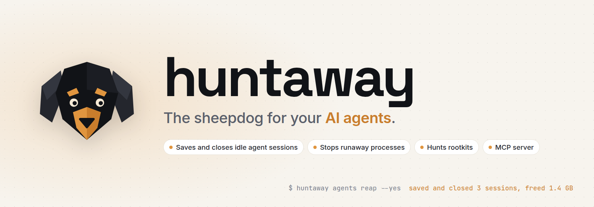
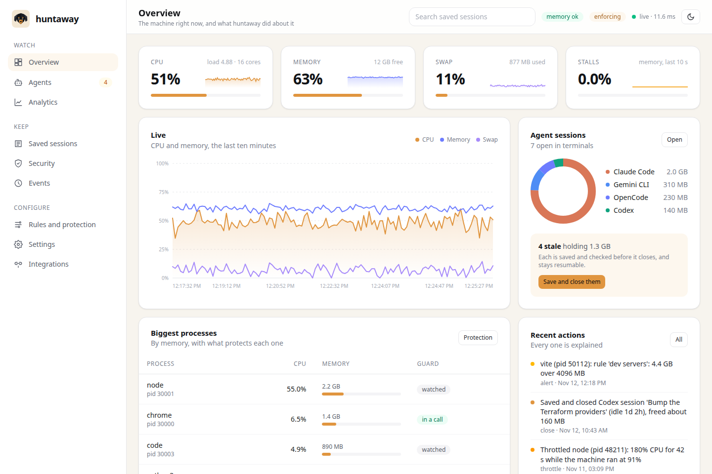

<p align="center">
  <picture>
    <source media="(prefers-color-scheme: dark)" srcset="docs/images/banner-dark.png">
    
  </picture>
</p>

<p align="center">
  <a href="https://github.com/jpsanders/huntaway/actions/workflows/dev.yml"></a>
  <a href="https://github.com/jpsanders/huntaway/releases/latest"></a>
  <a href="https://www.python.org/"></a>
  <a href="LICENSE"></a>
  
  <a href="#for-agents"></a>
  
  <a href="https://mypy-lang.org/"></a>
  <a href="https://github.com/psf/black"></a>
  <a href="https://github.com/jpsanders/huntaway/commits/main"></a>
  <a href="https://github.com/jpsanders/huntaway/stargazers"></a>
</p>

huntaway is a light background service for machines where AI coding agents run. It saves and closes agent sessions
left idle, stops runaway processes before the machine freezes, and hunts rootkits. It explains every action, serves
a dashboard on localhost, and gives your agents an MCP server so they can ask it the same questions you can.

One Python process, one dependency, about 40 MB of memory, and 13 ms of CPU each time it looks at 1,500 processes.

```sh
uv tool install git+https://github.com/jpsanders/huntaway
huntaway service install --observe && huntaway ui
```

<p align="center">
  <picture>
    <source media="(prefers-color-scheme: dark)" srcset="docs/images/dashboard-dark.png">
    
  </picture>
</p>

## Why

Every Claude Code, Codex or OpenCode session you leave open in a terminal holds 300 to 900 MB, waiting for you. Open
a few a day for a week and the machine swaps, the fans spin, and one afternoon the kernel kills your browser in the
middle of a call. On 12 November 2026 one workstation had 27 Claude Code sessions open, holding 8.6 GB; 20 of them
had been idle for more than a day. Closing them by hand means losing track of what each one knew, and Claude Code
deletes its own transcripts after 30 days anyway.

huntaway closes them for you without losing anything. Each session is saved, the copy is checked byte for byte, the
session is closed, and its own terminal shows the one line that brings it back.

## What it does

**Saves and closes idle agent sessions.** It finds Claude Code, Codex, OpenCode, Gemini CLI, Qwen Code, Aider,
Cursor Agent, Goose, Amp, Copilot CLI, Crush and Kiro sessions, reads each harness's own state to tell working from
idle from waiting on you, and after 12 idle hours (your choice) saves the transcript, verifies it, closes the
session and prints the resume command in its terminal. Every saved transcript is searchable.

**Keeps the machine from freezing.** When memory runs short it acts before the kernel's OOM killer does. Idle agent
sessions go first, because closing them loses nothing. Then the biggest process that is not protected gets SIGTERM,
and SIGKILL after a grace period. Processes that hog the CPU are dropped to the lowest priority instead of killed.
Your desktop, terminals, sound, ssh, password managers and any app in a call are never touched.

**Hunts.** Quick checks every six hours, no root needed: new lines in `.bashrc` and `.zshrc`, new cron jobs and SSH
keys, programs running from `/tmp`, crypto miners, ports newly open to your network, keys other users can read, and
agent CLIs started with their permission checks off by something without a terminal, which is how the s1ngularity
supply chain attack used them in 2025. Deep scans with rkhunter, chkrootkit, ClamAV and Lynis run weekly as root,
and their output becomes findings you can read, with rkhunter's usual false alarms marked as such.

**Explains itself.** Every action is an event with the numbers behind it. `huntaway why node` answers "who killed
my dev server". The dashboard shows a year of history: CPU, memory, swap, pressure stalls, disk, network,
temperature, the memory your agents hold, the apps that used the most CPU, and when in the week your machine works.

## Install

It needs Linux, or macOS (newer, and tested in CI only), and Python 3.14 or later. uv fetches a suitable Python by
itself.

```sh
uv tool install git+https://github.com/jpsanders/huntaway
```

or `pipx install git+https://github.com/jpsanders/huntaway`, or the installer, which installs uv when it is missing
and then the service in observe mode:

```sh
curl -fsSL https://raw.githubusercontent.com/jpsanders/huntaway/main/install.sh | sh
```

Want to look first? `huntaway demo` serves the dashboard on made up data and touches nothing.

## Quick start

```sh
huntaway service install --observe   # a systemd user service (launchd on macOS); records, never acts
huntaway ui                          # open the dashboard
huntaway agents                      # your agent sessions: idle time, memory, stale or not
huntaway agents reap                 # which ones would be closed, and what that frees
huntaway integrate                   # MCP server and skill for Claude Code, Codex, OpenCode, Gemini, Cursor
huntaway config set general.mode enforce   # once the events look right
```

```text
$ huntaway agents
HARNESS      PID    SESSION                                       STATUS   IDLE    MEMORY  VERDICT
Claude Code  41000  Refactor the billing service to use idempote  working  0s      610 MB  working
Claude Code  41371  Fix the flaky checkout test                   idle     3h 12m  540 MB  idle 3h 12m of 12h
Claude Code  41742  Write the Q3 data quality report              idle     19h     480 MB  stale
Codex        42113  Migrate CI from pip to uv                              1d 2h   140 MB  stale
OpenCode     42484  Add dark mode to the docs site                         41m     230 MB  idle 41m of 12h
Gemini CLI   42855  Summarise the incident timeline               waiting  2d 2h   310 MB  stale
Claude Code  43226  Upgrade Postgres 16 to 17                     idle     5d      450 MB  stale

7 sessions, 2.7 GB. 4 stale, 1.3 GB.
Close the stale ones (each is saved first): huntaway agents reap --yes
```

When a session is closed, its terminal says:

```text
huntaway saved and closed this Claude Code session after idle 19h.
  saved to  ~/.local/share/huntaway/sessions/claude/0b6f2c4e-...
  resume    cd ~/work/data-pipeline && claude --resume 0b6f2c4e-...
```

## Saved sessions

Each saved session keeps the original files (compressed with zstd and checked by SHA-256), a readable Markdown
transcript, the tmux scrollback when there is one, and the resume command. Search them all by what was said:

```sh
huntaway sessions "stripe webhook signature"
huntaway sessions show claude:0b6f2c4e
huntaway sessions restore claude:0b6f2c4e   # put the files back after the harness deleted its copy
```

Turn on `sessions.backup` and every transcript on disk is saved every six hours, open or not, so nothing ages out.

## For agents

`huntaway integrate` registers the MCP server and installs a skill in every harness it finds, using each harness's
own CLI where there is one. By hand, for any MCP client:

```json
{"mcpServers": {"huntaway": {"command": "huntaway", "args": ["mcp"]}}}
```

Seventeen tools, among them `status`, `list_agent_sessions`, `close_agent_session`, `search_saved_sessions`,
`read_saved_session`, `events`, `analytics` and `security_findings`. The ones that change something carry the MCP
destructive hint, so your harness asks before calling them, and no agent can close the session it runs in. The
same server is at `http://127.0.0.1:4868/mcp` for clients that speak HTTP.

Every CLI command takes `--json`. `huntaway guide` prints the full manual as Markdown, written for people and agents
alike. `huntaway run -- cargo build` runs a heavy job capped in its own systemd scope instead of having it stopped.

## The LLM judge

Off by default. Turn it on and a language model reviews a decision before huntaway ends a process. It can spare a
process; it can never end one, so a wrong or manipulated answer can at most leave a process running. Memory
emergencies never wait for it. It runs on its own thread, treats process names as untrusted data, and points at a
local Ollama by default, so nothing leaves the machine.

```sh
huntaway judge veto --model qwen3:4b
```

## Safe by default

- **Observe mode** records what huntaway would do and changes nothing. Start there.
- **Protected by default:** process 1, kernel threads, other users' processes, desktops, display servers, sound,
  terminals and tmux (closing one closes every tab), ssh, keyrings, password managers, Zoom and Teams, and any
  browser holding your microphone or camera.
- **Never the wrong process:** every action checks the process id and its start time first.
- **Never lost:** a session is closed only after its saved copy reads back identical. Working sessions and pinned
  sessions are never closed.
- **Local:** the dashboard listens on 127.0.0.1. Open it to your network and every request needs a token. Host
  header checks stop DNS rebinding and cross origin writes are refused.

## Configuration

One commented TOML file, `~/.config/huntaway/config.toml`, every option documented in place. Change it in the
dashboard, with `huntaway config set`, or in your editor; the service reloads it within seconds.

```toml
[agents]
idle_hours = 6

[memory]
min_available_percent = 8

[protect]
names = ["obs", "steam"]

[[rules]]
name = "dev servers"
match = "node .*(vite|next dev|webpack)"
memory_mb = 4096
action = "terminate"
```

The full guide is `man huntaway`, `huntaway guide`, or [docs/MANUAL.md](docs/MANUAL.md).

## Compared with

| | huntaway | earlyoom | systemd-oomd | htop, btop |
| --- | --- | --- | --- | --- |
| Acts before the machine freezes | yes | yes | yes | no |
| Knows which processes are AI agent sessions | yes | no | no | no |
| Saves a session before closing it | yes | no | no | no |
| Throttles CPU hogs instead of killing | yes | no | no | by hand |
| Protects calls, terminals and the desktop | yes | by name | by unit | n/a |
| Security checks and deep scans | yes | no | no | no |
| Dashboard with history | yes | no | no | live only |
| MCP server for agents | yes | no | no | no |

earlyoom and systemd-oomd are good at one job, and huntaway does not replace the kernel's own OOM killer, which still
runs underneath. huntaway adds the part they cannot know: which memory is an idle conversation you can save and
close at no cost.

## Why the name

The huntaway is a New Zealand sheepdog. It works the hills on its own and moves the flock with its voice. This one
watches your agents while you work, brings strays home, keeps the pen from overflowing, and barks when something
gets in. Its port is 4868, which spells HUNT on a phone keypad.

huntaway grew out of SENTINEL, the watchdog that guarded the author's Linux workstation from May 2026. Between June
and November it stopped 312 processes: Chrome 187 times, Claude Code 10 times, and the GNOME desktop 9 times, taking
every open window with it. Each of those is a rule in huntaway now: the desktop, terminals and calls are protected,
CPU hogs are slowed instead of killed, and an agent session is never closed before it is saved.

## Development

```sh
git clone https://github.com/jpsanders/huntaway && cd huntaway
python3.15 -m venv .venv && . .venv/bin/activate
make init-dev
make checks      # isort, black, editorconfig, darglint, flake8, mypy strict, bandit, man page, pytest
make css         # rebuild the dashboard's Tailwind stylesheet (downloads the standalone CLI, no Node)
make man         # rebuild the man page from docs/MANUAL.md and the settings schema
make demo        # the dashboard on made up data
```

The project started from [python-package-template](https://github.com/jpsanders/python-package-template). See
[CONTRIBUTING.md](CONTRIBUTING.md) and [SECURITY.md](SECURITY.md).

## Star history

<a href="https://star-history.com/#jpsanders/huntaway&Date">
  <picture>
    <source media="(prefers-color-scheme: dark)" srcset="https://api.star-history.com/svg?repos=jpsanders/huntaway&type=Date&theme=dark">
    
  </picture>
</a>

## Licence

MIT. Made by [James Phillip Sanders](https://jamesphillipsanders.com).
